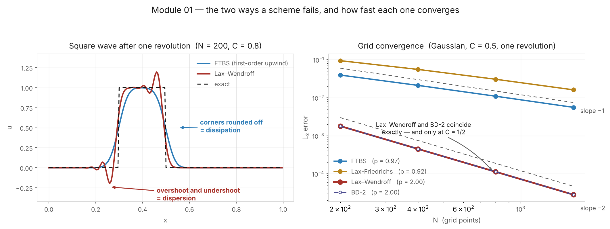
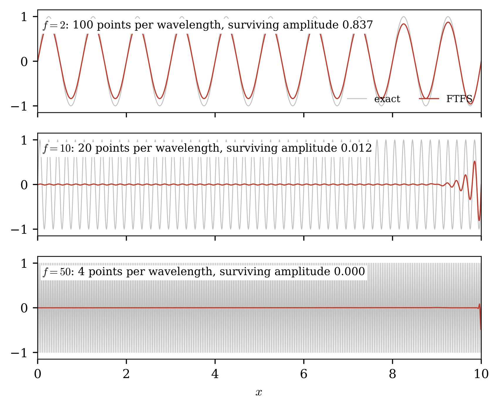
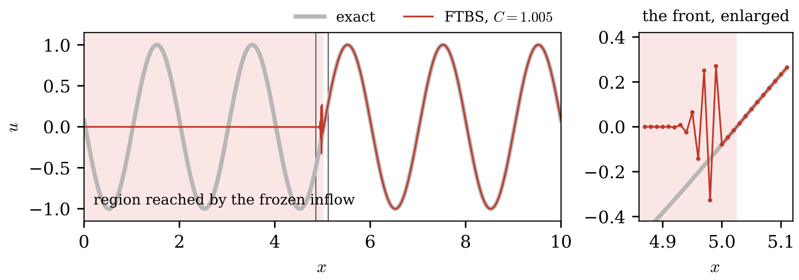
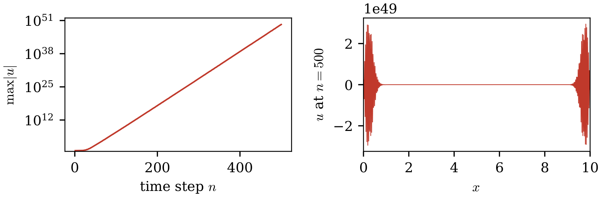
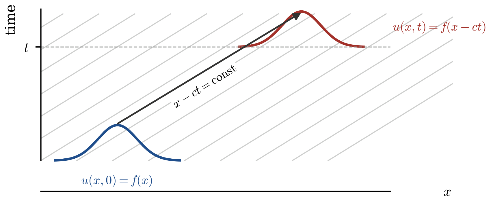
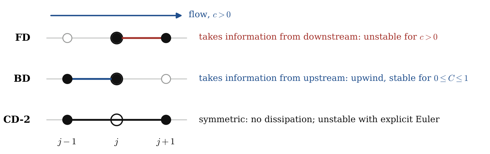

# 01 — Linear advection

*[← CFD from Scratch](../)  ·  module 1 of 6  ·  [next: Spectral analysis →](../02-spectral-analysis/)*

$$\frac{\partial u}{\partial t} + c\,\frac{\partial u}{\partial x} = 0$$

The simplest PDE that transports something, and the right place to start,
because its exact solution is known for *any* initial condition. Every
deviation a solver produces is therefore pure numerical error — nothing is
hiding behind an imperfectly known answer.

Six finite-difference schemes, implemented from the discretisation up, with the
derivations that produce them and the tests that prove they behave as derived.



*Left: a square wave after one full revolution. Upwind rounds the corners off —
that is dissipation. Lax–Wendroff keeps them sharp but grows overshoot and
undershoot — that is dispersion. They are different failures, not degrees of the
same one.*

*Right: the measured orders. Lax–Wendroff and BD-2 land on top of each other,
which is not a plotting accident — at `C = 1/2` their leading dispersive
coefficients, `(1 − C²)` and `(1 − C)(2 − C)`, are equal. Regenerate with
`python3 make_figures.py`.*

---

## Verification

Measured on a Gaussian (`σ = 0.1`) advected once round a periodic domain at
`C = 0.5`. The order `p` is `log₂(e_coarse / e_fine)` between the two finest
grids.

| Scheme | N=200 | N=400 | N=800 | N=1600 | measured `p` | formal | stability |
|---|---|---|---|---|---|---|---|
| FTBS (upwind) | 3.952e-02 | 2.115e-02 | 1.097e-02 | 5.588e-03 | **0.97** | 1 | `0 ≤ C ≤ 1` |
| Lax–Friedrichs | 9.448e-02 | 5.566e-02 | 3.064e-02 | 1.615e-02 | **0.92** | 1 | `\|C\| ≤ 1` |
| Lax–Wendroff | 1.800e-03 | 4.503e-04 | 1.126e-04 | 2.815e-05 | **2.00** | 2 | `\|C\| ≤ 1` |
| BD-2 (Beam–Warming) | 1.800e-03 | 4.503e-04 | 1.126e-04 | 2.815e-05 | **2.00** | 2 | `0 ≤ C ≤ 2` |
| FTCS | — | — | — | — | — | — | unconditionally unstable |
| FTFS (downwind) | — | — | — | — | — | — | unconditionally unstable |

Four further checks, all passing:

- **Exactness at `C = 1`.** Upwind reduces to `u_new[i] = u[i-1]` — an exact
  one-cell shift. Run on a *square wave*, where any dissipation or dispersion
  would show up immediately: **max error 0.000e+00**.
- **Conservation.** `Σu·Δx` over 5 domain transits: drift **≤ 2.2e-16** for
  every convergent scheme. Numerical error redistributes `u`; it does not
  create or destroy it.
- **Instability is real.** FTCS and FTFS reach `10¹²` and `10¹¹²`. A positive
  control — it proves the test setup can actually detect divergence.
- **LW and BD-2 coincide at exactly `C = 1/2`.** See below.

---

## The experiments this module came out of

Three runs from August, before any of the above existed. Each one failed in a
way I could not explain at the time, and each failure is a section of
[module 02](../02-spectral-analysis/) or of the theory below. Figures from the
[report](../report/) (§3.1–3.4); the first three regenerate with
`python3 ../report/make_all_figures.py`.

**12 August — the same scheme, the same grid, three different answers.**



`sin(fπx)` for `f = 2, 10, 50` on one grid — 1001 points, `L = 10`, `|C| = 0.1`,
advected for one time unit by FTFS. The only difference between the panels is
how many grid points cover one wavelength: **100, 20 and 4**. The surviving
amplitudes are **0.837, 0.012 and 0.000**.

The same scheme is excellent for one wave and useless for another. Nothing in
the order of accuracy says which — that is a statement about `Δx → 0`, and this
is one fixed grid. Predicting all three numbers in advance is what
[module 02](../02-spectral-analysis/) does.

**20 August — a run that was wrong twice over, and looked fine.**



FTBS at `C = 1.005`, 500 steps. Two independent bugs in one plot:

- The inflow value `u₀` was never updated — the line that did it was commented
  out. Everything the inflow has reached, about **half the domain**, is zero.
  `max(u)` cannot see a region that is simply *missing*; it read 1.0011, within
  0.12 % of exact.
- `C = 1.005` is past the stability limit, so the run was also unstable. The
  enlargement shows the fastest-growing mode as a sawtooth of amplitude ≈ 0.3,
  seeded by the kink where the dead region meets the sine. It had not yet grown
  enough to disturb `max(u)` either.

A scheme past its stability limit can look stable for a long time, and the
amplitude check I was using could not detect either fault. The frozen boundary
is `BUGS.md` #1; why the unstable mode stayed so small is module 02.

**21 August — the most accurate stencil gives the worst scheme.**



The central difference is second-order where FD and BD are first-order, so FTCS
should have been the best of the three. It grew by about the same factor every
step and reached `2.95 × 10⁴⁹` after 500. The growth starts at the two ends,
where the boundary values are never updated and the solution has a jump.

**Spatial accuracy and stability are independent properties.** This result is
what sent me to the theory, and `|G| > 1` for every mode of FTCS is derived in
[module 02](../02-spectral-analysis/).

---

## The one experiment so far

Lax–Wendroff and Beam–Warming produced *identical* errors to four digits at
`C = 0.5`. That looked like a bug. It is a prediction.

LW's leading dispersive coefficient scales as `(1 − C²)`; Beam–Warming's as
`(1 − C)(2 − C)`. The ratio is `(1+C)/(2−C)`, which equals 1 at `C = 1/2` and
nowhere else:

| `C` | LW error | BD-2 error | measured ratio | `(1+C)/(2−C)` |
|---|---|---|---|---|
| 0.3 | 5.4624e-04 | 7.1423e-04 | 0.7648 | 0.7647 |
| 0.5 | 4.5030e-04 | 4.5030e-04 | 1.0000 | 1.0000 |
| 0.8 | 2.1614e-04 | 1.4410e-04 | 1.4999 | 1.5000 |

Two structurally different schemes crossing at one Courant number, matched to
four significant figures by a two-term Taylor argument.

---

## Theory

Written to be self-contained — a reader needs derivatives and power series,
nothing more. Every algebraic step is shown.

- **[01 — Why the solution is `f(x − ct)`](theory/01-analytical-solution.md)**
  Three independent derivations: method of characteristics (which also explains
  *why* upwinding works), change of variables, and separation of variables into
  Fourier modes. The last establishes that the exact equation has `|G| = 1` and
  `c_p = c` for every wavenumber — the baseline against which all numerical
  dissipation and dispersion is measured.

  

  *The whole equation in one picture: `u` is constant along every line
  `x − ct = const`, so the initial profile is carried rigidly to the right at
  speed `c` and never changes shape. The solution is `f(x − ct)` because it
  cannot be anything else.*

- **[02 — Where finite-difference stencils come from](theory/02-finite-difference-stencils.md)**
  FD-1, BD-1, CD-2, BD-2, CD-4 and the second-derivative CD-2, all derived from
  Taylor series by one repeated method. Includes the general recipe for
  constructing any stencil, and the structural result that one-sided stencils
  have even-derivative (dissipative) leading error while symmetric ones have
  odd-derivative (dispersive) error.

  Stencils verified numerically — measured orders 1.01, 0.99, 2.00, 2.02, 4.00,
  with leading truncation coefficients matching theory to four significant
  figures.

  

  *Why "upwind" is a direction and not a formula. For `c > 0` information
  arrives from the left, so BD reads the point the information came from and FD
  reads one the flow has not reached yet. CD-2 is symmetric and so commits to
  neither — which is why it is a better approximation to `u_x` and still an
  unusable scheme with explicit Euler.*

---

## Code

| File | Purpose |
|---|---|
| `advection_1d.py` | Standalone upwind solver. Explicit loops, no NumPy tricks — start here. |
| `BUGS.md` | The four bugs in the first version, and what they cost. |
| `src/schemes.py` | All six schemes, uniform `step(u, C)` interface. |
| `src/initial_conditions.py` | Grid, four initial conditions, exact solution. |
| `src/solver.py` | Time-marching driver and L2 error. |
| `demo.py` | Runs every scheme once and prints the errors. |
| `tests/` | Verification suites. |

The design decision that matters: **every scheme has the identical signature
`step(u, C) → u_new`**, knowing nothing about grids or final times. Because
they are interchangeable from outside, the convergence study, the spectral
analysis in module 02 and every future experiment loop over a dictionary of
schemes with no special cases.

`advection_1d.py` uses explicit loops and index arithmetic; `src/schemes.py`
uses `np.roll` and is 3–200× faster depending on grid size.
`tests/test_equivalence.py` proves the two are bit-for-bit identical, which is
also the clearest available explanation of what `np.roll` does.

## Running

```bash
pip install numpy matplotlib
python3 advection_1d.py          # the standalone solver
python3 demo.py                  # all six schemes compared
python3 tests/test_equivalence.py
python3 tests/test_convergence.py
python3 make_figures.py          # regenerates figures/
```

---

## What I learned that isn't in a textbook

- **The bugs you can find are limited by the diagnostic you choose.** A frozen
  inflow boundary destroyed 10% of the domain — 100% error at `x = 0.5` — and
  it was invisible because I was only printing `max(u)` and `min(u)`, which
  looked like ordinary dissipation.
- **A convergence table that disagrees with theory usually means the test is
  under-resolved, not that the scheme is broken.** FTBS measured `p = 0.71`
  until the Gaussian was wide enough to resolve on the coarse grids.
- **A test that cannot fail is not a test.** My first frozen-boundary check
  used `sin(πx)`, where `u[0] = 0` — so a completely frozen boundary would have
  passed too. It only "passed" on the difference between `+0.0` and `−0.0`.
- **Spatial order and stability are independent.** A second-order upwind
  stencil marched with plain forward Euler is unconditionally unstable, exactly
  like FTCS. Beam–Warming needs its `C²` term to be second order in *time*.
- **Order of accuracy is a statement about the limit `Δx → 0`.** It says how
  fast error falls under refinement, not which scheme is better on the grid you
  can afford. Answering that second question is what module 02 is for.
