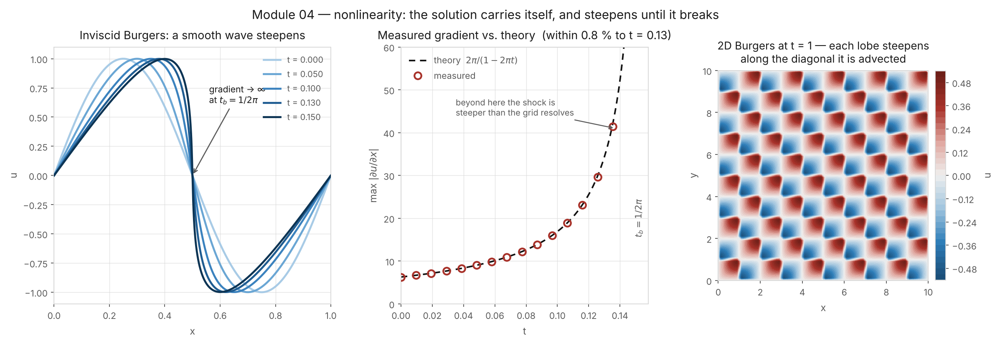
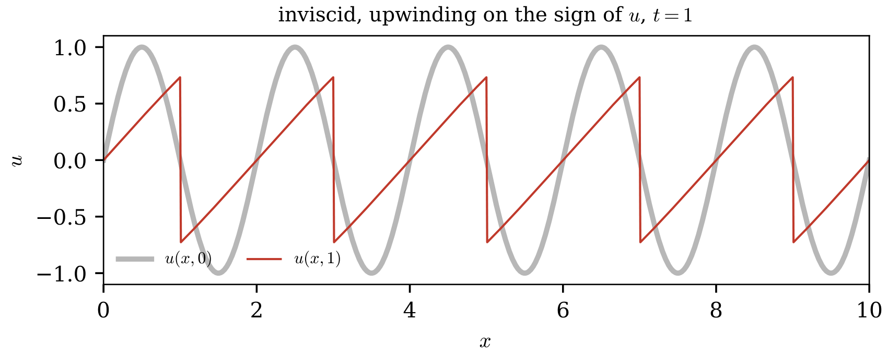
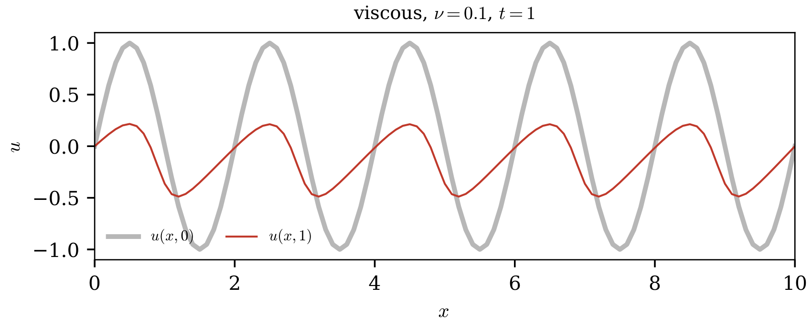

# 04 — Burgers equation

*[← CFD from Scratch](../)  ·  module 4 of 6  ·  [← prev: 2D advection](../03-advection-2d/)  ·  [next: Poisson →](../05-poisson/)*

$$\text{1D:}\quad u_t + u\,u_x = \nu\,u_{xx} \qquad\qquad \text{2D:}\quad u_t + u\,u_x + v\,u_y = \nu(u_{xx}+u_{yy})$$

The first nonlinear equation in this repository. The advection speed is now the
solution itself, which changes three things that modules 01 and 03 could not
show.



*Left: a smooth sine steepens because fast parts of the wave overtake slow ones.
Centre: the maximum gradient measured against its closed form
`2π/(1 − 2πt)`, which diverges at `t_b = 1/2π ≈ 0.159`. Right: the 2D solver on
the original hand-written setup. Regenerate with `python3 make_figures.py`.*

---

## What is genuinely new

**1. The upwind direction is no longer known in advance.** With `c > 0` fixed,
a backward difference was always correct. Here the sign of the velocity varies
across the domain, so the direction must be chosen per grid point, per timestep:

```
u > 0  ->  information arrives from the LEFT   ->  backward difference
u < 0  ->  information arrives from the RIGHT  ->  forward difference
```

This is **conditional upwinding**, and it is not a stylistic choice.
`tests/` includes a negative control that uses a fixed backward direction
everywhere: on `sin(2πx)`, which is negative over half the domain, it reaches
`NaN` while the conditional version stays bounded at `0.841`. Where `u < 0`, a
backward difference is *downwind* — the anti-diffusive case from module 01.

In 2D, note which velocity selects which direction: the x-derivative of **both**
`u` and `v` is upwinded on the sign of `u`, because `u` is the advecting
velocity in `x`. Using `v` to upwind a `v_x` term is a natural-looking mistake
and is wrong.

**2. Shocks.** A perfectly smooth initial condition develops a discontinuity in
finite time. Characteristics carry `u` at speed `u`, so they cross at

$$t_{\text{break}} = \frac{1}{\max|u_0'(x)|}$$

and before that the maximum gradient has a closed form,
`max|u_x|(t) = 2π/(1 − 2πt)` for `u₀ = sin(2πx)`. Measured against it:

| `t` | measured `max\|u_x\|` | theory | error |
|---|---|---|---|
| 0.000 | 6.28 | 6.28 | 0.00% |
| 0.050 | 9.16 | 9.16 | 0.04% |
| 0.100 | 16.87 | 16.90 | 0.23% |
| 0.130 | 33.99 | 34.30 | 0.91% |

with `t_break = 1/(2π) = 0.1592`. A prediction that gives a *number at every
instant* and diverges at a *specific time* is far stronger evidence than "the
gradient goes up".

**3. Two independent stability limits.** The viscous term adds a constraint
unrelated to the CFL condition, and both must hold:

```
advective:  dt <= 1 / (|u|/dx + |v|/dy)
diffusive:  dt <= 0.5 / (nu (1/dx^2 + 1/dy^2))
```

| `ν` | `dt` advective | `dt` diffusive | binding |
|---|---|---|---|
| 1e-04 | 0.0500 | 25.0000 | advective |
| 1e-03 | 0.0500 | 2.5000 | advective |
| 1e-02 | 0.0500 | 0.2500 | advective |
| 1e-01 | 0.0500 | 0.0250 | **diffusive** |

Refining the grid tightens the diffusive limit as `dx²` but the advective limit
only as `dx`, so on fine grids the viscous term usually decides the timestep.

---

## The original version

`experiments/first_attempt_2d.py` is my hand-written 2D Burgers solver, kept
unchanged. It is **correct** — the conditional upwinding, the choice of which
velocity selects each direction, and the two-array update are all right, and the
Dirichlet boundary is legitimate here because `sin(πx)sin(πy)` is exactly zero
on all four edges of `[0,10]²`.

Two things about it are worth recording:

- It ran at `dt = 0.0001`, which is **CFL 0.002 — about 500× smaller than
  stability requires**. At `dt = 0.01` the answer changes by 0.5%
  (`max u = 0.5199` versus `0.5224`) for one hundredth of the work.
- The nested Python loops take **~10.6 minutes** for the full 10 000 steps. The
  vectorised version in `src/burgers.py` does it in 0.06 s and agrees to
  `1.2e-15` (`tests/test_equivalence_burgers.py`).

---

## A mistake worth reading

The shock test failed on its first run, which looked like a solver bug. It was
not — my predicted breaking time was wrong (`1/(4π²)` instead of `1/(2π)`).

What settled it: the measured gradient at `t = 0.1` was **16.46, 16.72, 16.82,
16.87** at `N = 200, 400, 800, 1600`. Essentially independent of the grid.
A numerical artefact changes when you change the grid; a converged physical
answer does not. **Grid-independence is how you tell a real result from a
numerical one**, and here it pointed straight at the theory rather than the code.

---

## The two original runs



*Figure 6.1 of the [report](../report/) — `1D_advection_nonlinear.py`, 1001
points, `Δt = 0.001`, upwinding on the sign of `u`.*

`sin(πx)` carried by itself for one time unit. Each crest overtakes the trough
ahead of it until the profile is vertical, and after that the scheme holds the
front in a few cells as a sawtooth. **The upwind direction is no longer a
property of the equation** — `c` has been replaced by `u`, which changes sign
twice per wavelength, so the stencil has to be chosen point by point and step by
step. That `if/else` is the advection scheme of the cavity solver in
[module 06](../06-lid-driven-cavity/).

### The lopsided waves



*Figure 7.1 of the [report](../report/) — the same problem with `ν = 0.1` added,
101 points, and **backward differencing everywhere**, including where `u < 0`.*

This run did not blow up and I saw nothing wrong with it at the time. The figure
shows it anyway. The exact solution inherits the antisymmetry of its initial
condition, `u(10 − x, t) = −u(x, t)`: **the troughs must be exactly as deep as
the peaks are high.** These reach **−0.49 and +0.21**.

The arithmetic is the modified equation from
[module 01](../01-linear-advection/), applied twice with opposite signs. With
`Δx = 0.1` and `|u| ≤ 1`, the backward difference adds a numerical viscosity of
up to `|u|Δx/2 = 0.05` where `u > 0` — and where `u < 0` that same stencil is
*downwind*, so it **subtracts** 0.05 instead. One half of every wave felt a
viscosity of up to 0.15, the other as little as 0.05.

The scheme stayed stable only because the physical `ν = 0.1` was larger than the
0.05 the wrong stencil was removing, so the total never went negative. Fixing
the stencil gives symmetric waves of `±0.27` on the same grid, and `±0.31` on
one twenty times finer.

> **Physical diffusion can keep a wrong scheme stable. It does not make it
> right.**

Nothing but knowing what the answer should look like caught this. The symmetry
was available for free, before the run, from the initial condition alone — which
is the cheapest kind of check there is and the reason this module has
`tests/test_equivalence_burgers.py` rather than a visual inspection.

---

## Code

| File | Purpose |
|---|---|
| `experiments/first_attempt_2d.py` | The original hand-written solver, unchanged |
| `src/burgers.py` | Vectorised 1D and 2D, plus the stability-limit helper |
| `tests/test_equivalence_burgers.py` | Five checks |

## Running

```bash
python3 tests/test_equivalence_burgers.py
python3 make_figures.py                     # regenerates figures/
```
