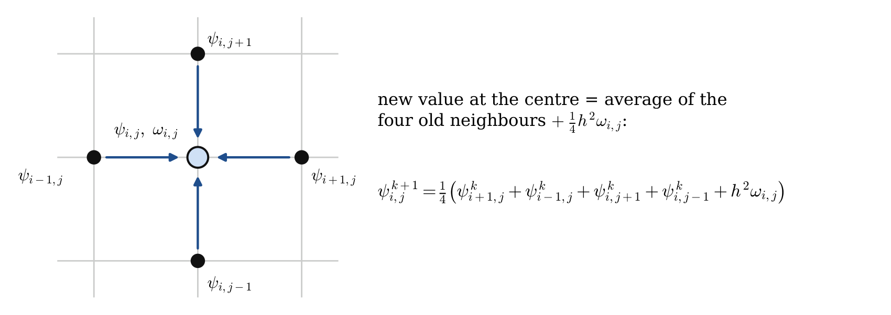
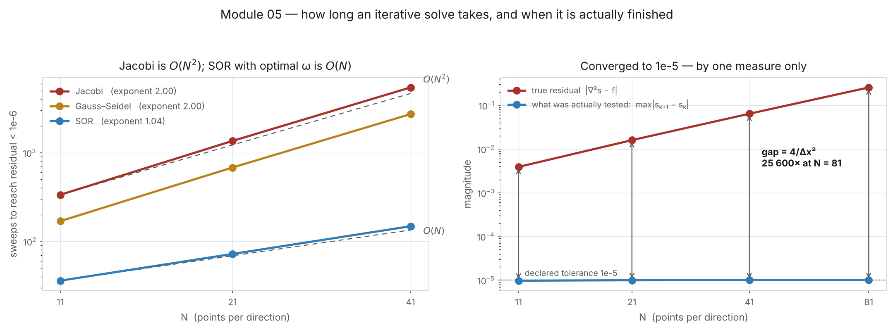
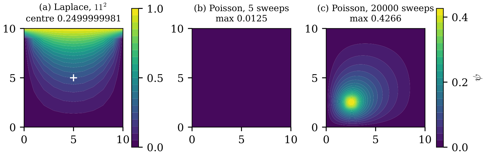

# 05 — Poisson and Laplace

*[← CFD from Scratch](../)  ·  module 5 of 6  ·  [← prev: Burgers](../04-burgers/)  ·  [next: Lid-driven cavity →](../06-lid-driven-cavity/)*

$$\nabla^2 s = f \qquad\text{with Dirichlet boundaries}$$

`f = 0` gives Laplace. For the lid-driven cavity the streamfunction satisfies
`∇²ψ = −ω`, so this module is the engine that runs inside every timestep of
module 06.

Three iterative methods on the five-point stencil derived in module 01, all
sharing one update and differing only in **which values they read on the right**.



*The whole method in one line. An elliptic equation has no time to march in —
every point depends on every other at the same instant — so it has to be settled
by iteration instead. A Jacobi sweep replaces each point by the average of its
four neighbours plus `h²ω/4`, reading only values from the previous sweep.
Figure 8.1 of the [report](../report/).*



*Left: iteration count is a complexity class, not a constant factor. Doubling the
grid roughly quadruples Jacobi's work and merely doubles SOR's.*

*Right: the stopping test that quietly lies. The blue line is what the first
version of this solver actually measured — the change per sweep, flat at the
declared `1e-5`. The red line is the residual it had genuinely reached. The gap
is `4/Δx²`, and it grows as the grid refines. Regenerate with
`python3 make_figures.py`.*

---

## Verification

Method of manufactured solutions: pick `s = sin(πx)sin(πy)`, substitute, and
whatever falls out (`f = −2π²s`) is the source term that makes it true. The
solver must then reproduce the function you started from.

| Solver | iterations (N=41) | `max\|s − exact\|` |
|---|---|---|
| Jacobi | 6933 | 5.142e-04 |
| Gauss–Seidel | 3468 | 5.142e-04 |
| SOR | 172 | 5.142e-04 |

Same answer from all three, agreeing to `4.5e-12` — three different iterations,
one linear system.

**Discretisation is second order**, exactly as the stencil derivation predicts:

| N | max error | ratio | order |
|---|---|---|---|
| 11 | 8.265e-03 | | |
| 21 | 2.059e-03 | 4.01 | **2.01** |
| 41 | 5.142e-04 | 4.00 | **2.00** |
| 81 | 1.285e-04 | 4.00 | **2.00** |

This is separate from iterative convergence. Even a perfectly converged
iteration leaves the stencil's own `−dx²/12 · u''''` error. Iterating harder
cannot beat it; only a finer grid can.

---

## Iteration count is a complexity question, not a constant factor

| N | `ω_opt` | Jacobi | Gauss–Seidel | SOR |
|---|---|---|---|---|
| 11 | 1.5279 | 335 | 169 | 36 |
| 21 | 1.7295 | 1356 | 680 | 72 |
| 41 | 1.8545 | 5441 | 2722 | 148 |

**Scaling exponent per grid doubling: Jacobi 2.00, SOR 1.04.** Jacobi is
`O(N²)`, SOR is `O(N)`. Gauss–Seidel is reliably half of Jacobi — new values
are used the moment they exist rather than waiting a full sweep.

SOR is Gauss–Seidel that deliberately overshoots:

```
s_new = (1 - omega) * s_old + omega * s_gauss_seidel
```

`ω = 1` is exactly Gauss–Seidel; `ω > 1` overshoots the correction. It sounds
reckless and it is the single largest speed-up available here. For a square
Dirichlet domain the optimum is known analytically,
`ω_opt = 2/(1 + sin(π/(N−1)))`, tending to 2 as the grid refines.

Inside a Navier–Stokes timestep loop this is the difference between a solver
that finishes and one that does not.

---

## The stopping test — the thing that would have bitten me

`experiments/first_attempt_laplace.py` stops when `max|s_new − s_old| < tol`:
how much the solution *changed* this sweep. That is not how well it *satisfies
the equation*. For Jacobi the two are related exactly:

```
change = residual * dx^2 / 4
```

so the residual is `4/dx²` times larger than the quantity being tested:

| N | dx | change | residual | ratio | `4/dx²` |
|---|---|---|---|---|---|
| 11 | 0.1000 | 9.74e-06 | 3.894e-03 | 400.0 | 400.0 |
| 21 | 0.0500 | 9.96e-06 | 1.593e-02 | 1599.9 | 1600.0 |
| 41 | 0.0250 | 1.00e-05 | 6.397e-02 | 6398.6 | 6400.0 |
| 81 | 0.0125 | 9.99e-06 | 2.556e-01 | 25583.4 | 25600.0 |

Because Jacobi converges slowly, the change per sweep goes small long before
the answer is right. **And the gap grows as `dx²`, so it is worst exactly when
you refine the grid to get a better answer.** At N=81 a solution reported as
converged to `1e-5` has a residual of `0.26`.

This is the kind of defect that produces a Ghia comparison that is subtly wrong
with no visible cause. Every solver in `src/poisson.py` tests the residual.

---

## The first two elliptic runs



*Figure 8.2 of the [report](../report/), from `2D_laplas_Jacobi.py` (2 September)
and `2D_Poisson.py` (8 September).*

**(a) A test with an answer I could check by hand.** Laplace on `11 × 11`, one
side held at 1 and three at 0. Rotate that problem four times and add the four
solutions: every side is now at 1, so the sum is 1 everywhere, and by symmetry
each of the four contributes equally. **The centre must be exactly `1/4`.** The
solver returns **0.2499999981**.

No reference solution, no benchmark, no manufactured source — just a symmetry
argument that pins one number exactly. It is the cheapest honest test in this
repository.

**(b, c) The run I labelled `diverged heheheh`.** A square patch of `ω = 1` on
`101 × 101`, capped at five sweeps. It had not diverged. After five sweeps the
change per sweep was still *exactly* 0.0025 — which is `h²ω/4`, precisely what
one sweep adds at the centre of the source — because the solution had barely
started to spread. Nothing was growing. Panel (b) is **3 % of the answer**:
`ψ_max = 0.0125` against **0.4266** after 20000 sweeps in panel (c), on the same
colour scale.

> **Diverging, not having converged yet, and having converged are three
> different states.** My message confused the first two.

This is the same confusion as the stopping test above, met from the other side:
there I trusted a small change per sweep, here I distrusted one. Both come from
reading the change per sweep as if it were the error. It is `h²/4` times the
residual — a factor of 400 on this grid (`L = 10`, 101 points, `h = 0.1`), and
40000 on the `101²` unit-square grid the cavity runs on.

---

## The original version

`experiments/first_attempt_laplace.py`, unchanged. The Jacobi update, the
Dirichlet boundaries and the two-array pattern are all correct. Besides the
stopping test above, one reporting bug: `print("Ittt =", max_iterations + 1)`
always prints 501 regardless of what happened. It converged at iteration
**152**. Should be `ti + 1` — which matters, because iteration count is the
entire point of comparing these three methods.

---

## Code

| File | Purpose |
|---|---|
| `experiments/first_attempt_laplace.py` | The original hand-written Jacobi solver |
| `src/poisson.py` | Jacobi, Gauss–Seidel, SOR, residual, optimal ω |
| `tests/test_poisson.py` | Five verification checks |

## Running

```bash
python3 tests/test_poisson.py
python3 make_figures.py         # regenerates figures/
```

## Where this goes

[Module 06](../06-lid-driven-cavity/) couples this to vorticity transport: solve
`∇²ψ = −ω` for the streamfunction, differentiate to get velocities, advect
vorticity, repeat. Verifying the Poisson solve in isolation first is what let
the cavity's later disagreement with the Ghia benchmark be attributed
confidently to the advection scheme — this piece was already ruled out.

Both results from this module showed up there in practice:

- The first cavity build stopped its Poisson iteration on the **change per
  sweep**, and paid the `4/Δx²` penalty derived above — at `N = 41` it was
  running **2151 Jacobi sweeps per timestep**.
- Switching to a *relative* residual tolerance and red–black SOR brought that to
  **8.7 sweeps per step** with the answer unchanged to five decimal places.
  That is the `O(N²)` → `O(N)` difference measured above, in a solver that
  actually needed it.
