# 06 — Lid-driven cavity (vorticity–streamfunction)

*[← CFD from Scratch](../)  ·  module 6 of 6  ·  [← prev: Poisson](../05-poisson/)*

$$\omega_t + u\,\omega_x + v\,\omega_y = \nu\nabla^2\omega, \qquad \nabla^2\psi = -\omega, \qquad u = \psi_y,\;\; v = -\psi_x$$

Everything in modules 01–05 meets here. Poisson solve for `ψ` (module 05),
velocities by central differences (module 01), wall vorticity from ghost points,
vorticity advected by conditional upwinding (module 04) with central diffusion,
marched explicitly.

**Status: validated at Re = 100. Higher-Re disagreement measured and attributed.**

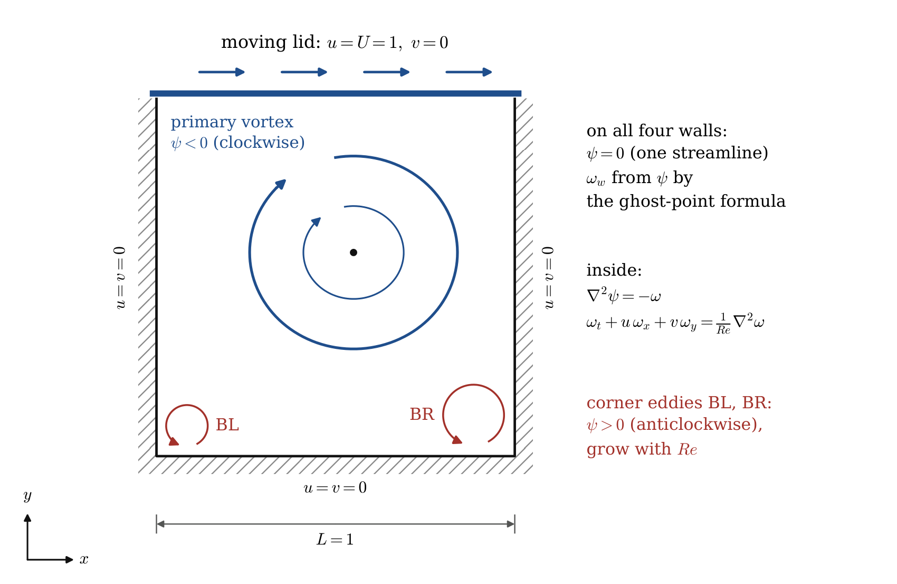

*The problem, and why it is the standard test. A square box, a lid sliding at
constant speed, no-slip everywhere else. All four walls are one streamline, so
`ψ = 0` on the whole boundary, and in units of `L`, `U` and `L/U` the only
parameter left is `Re = UL/ν`. The steady flow has a clockwise primary vortex
and counter-rotating corner eddies that grow with `Re`. Figure 9.1 of the
[report](../report/).*

### The timestep

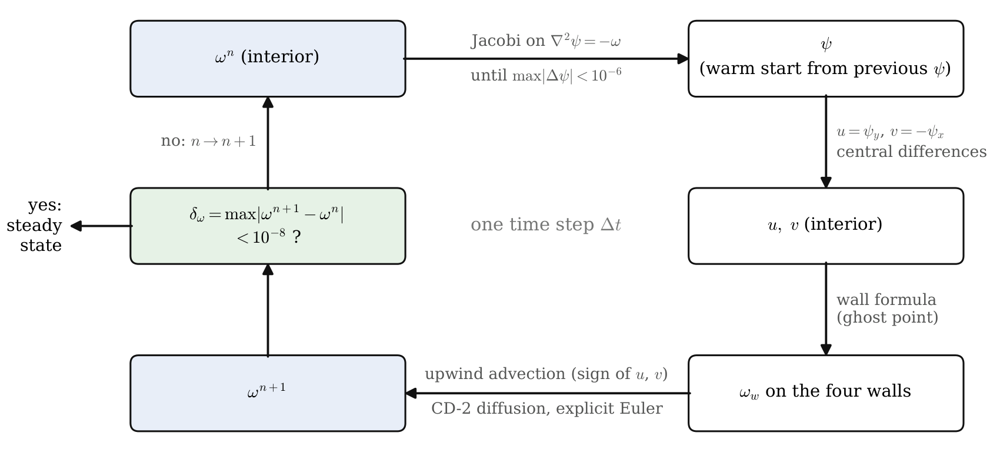

*Each step solves `∇²ψ = −ω` for the streamfunction (warm-started from the
previous `ψ`), differentiates it for `u` and `v`, sets the wall vorticity from
the ghost-point formula, then advects and diffuses `ω` by one explicit Euler
step. The loop exits when `δ_ω = max|ω^{n+1} − ω^n|` drops below `10⁻⁸`.
Figure 10.1 of the [report](../report/).*

Every box in that loop is a module 01–05 result except one. The walls carry no
boundary condition on `ω` — only on `ψ` and the velocity — so the wall vorticity
has to be **derived** from them:

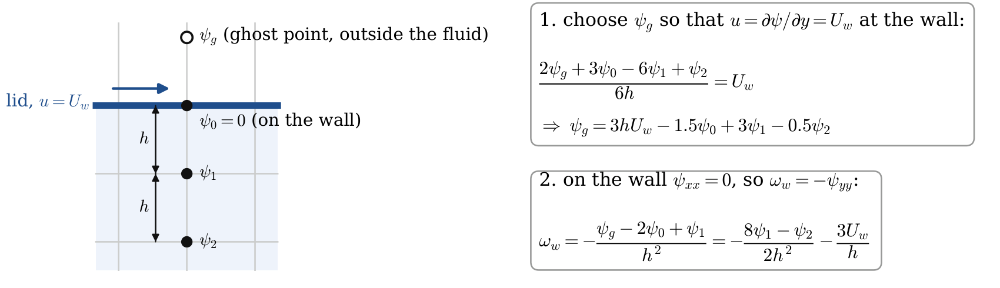

*Figure 9.2. Place a ghost point outside the fluid and choose its `ψ` so that
the one-sided derivative `∂ψ/∂y` equals the wall velocity; then use `ψ_xx = 0`
on the wall (it is a streamline) to turn `∇²ψ = −ω` into `ω_w = −ψ_yy`.
Eliminating the ghost point leaves `ω_w = −(8ψ₁ − ψ₂)/2h² − 3U_w/h`, which is
third-order accurate. The corners belong to two walls at once and are excluded.*

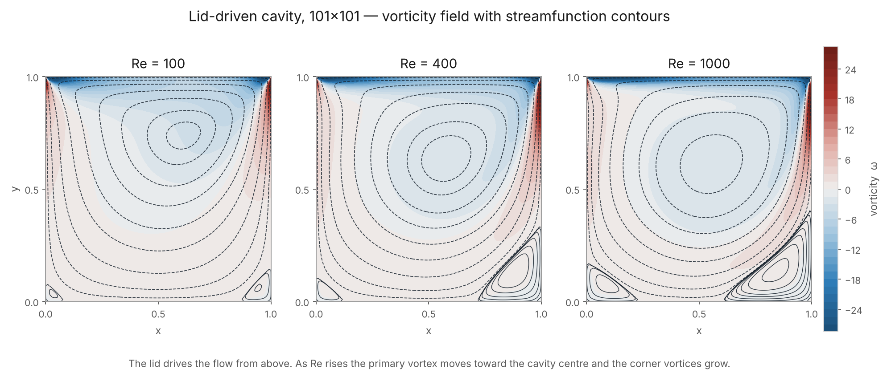

The converged flow at the three Reynolds numbers studied. The lid drives the
fluid from above; the primary vortex migrates toward the cavity centre as Re
rises, and the corner vortices — barely present at Re = 100 — grow steadily.
Regenerate with `python3 ../figures/make_hero.py`.

---

## The central result, stated before any comparison

The solver uses first-order upwind for vorticity advection. Module 01's modified
equation says that scheme adds a real diffusion:

```
nu_num = |u| dx (1 - C) / 2
```

In the vorticity transport equation this sits **directly alongside the physical
`ν`**. So the solver runs at `Re_eff ≈ UL/(ν + ν_num)`, not at `UL/ν`.

### Two forms of the same number

`ν_num` appears below in two forms, and mixing them up is easy, so both are
stated once here. They answer different questions.

**While the solver is marching**, the `(1 − C)` factor is real and `ν_num`
depends on the timestep.

**Once a run has converged, it does not.** The `C` in `(1 − C)` is the
timestep's share of `ν_num`, and a steady solution — one with `ω^{n+1} = ω^n` —
has stopped depending on `Δt` at all. Setting `|u| → U` and `ν = UL/Re` leaves

```
nu_num / nu = Re * dx / 2        (steady state, dx in units of L)
```

with no `Δt` in it. **Every result in this module is a converged steady run, so
this is the ratio they are quoted against.** It is also the upper bound on the
marching value, which is `(1 − C)` times it.

Near the lid (`|u| ≈ 1`):

| case | grid | `Δx` | `ν` | `ν_num` | `ν_num/ν` | `Re_eff` | `Re_cell` |
|---|---|---|---|---|---|---|---|
| Re=100 | 51² | 0.0200 | 0.0100 | 0.0100 | 1.00 | 50 | 2.00 |
| Re=100 | 101² | 0.0100 | 0.0100 | 0.0050 | 0.50 | 67 | 1.00 |
| Re=100 | 201² | 0.0050 | 0.0100 | 0.0025 | 0.25 | 80 | 0.50 |
| Re=400 | 101² | 0.0100 | 0.0025 | 0.0050 | **2.00** | 133 | 4.00 |
| Re=1000 | 101² | 0.0100 | 0.0010 | 0.0050 | **5.00** | 167 | 10.00 |
| Re=1000 | 201² | 0.0050 | 0.0010 | 0.0025 | **2.50** | 286 | 5.00 |

Produced by `steady_ratio()` in `src/numerical_viscosity.py`; the same numbers
are Table 12.1 of the [report](../report/), which tabulates them for all seven
Reynolds numbers and four grids.

With an interior speed `|u| ≈ 0.2` the effective Reynolds numbers are higher —
the truth lies between, and is worst near the lid.

**`ν_num` depends on `Δx`, not on `ν`.** Raise the target Re at fixed grid and
`ν` falls while `ν_num` stays put, until it dominates. At Re = 1000 on 101² the
numerical viscosity is **5× the physical**.

### Three predictions this makes

1. Re = 100 should agree well with Ghia.
2. Agreement should degrade monotonically with Re, and most sharply across
   Re = 100 → 400, where the ratio crosses 1.
3. Refining 101² → 201² at Re = 1000 should move the solution measurably toward
   Ghia — and by **more** than the same refinement achieves at Re = 100, where
   `ν_num` was never the limiting factor.

Prediction 3 is the interesting one: grid refinement should do something
*qualitatively different* at high Re. "Finer is better" does not predict that.

### A corollary that catches people out

This one needs the marching form. `ν_num = |u|Δx(1 − C)/2` is **largest as
`Δt → 0`**. At `Δx = 0.01`, `|u| = 1`:

| `Δt` | `C` | `ν_num` |
|---|---|---|
| 5e-03 | 0.50 | 0.002500 |
| 1e-03 | 0.10 | 0.004500 |
| 1e-04 | 0.01 | 0.004950 |
| → 0 | → 0 | 0.005000 |

**Shrinking the timestep to be safe makes numerical diffusion worse**, and it
converges to exactly the steady-state value in the last row. Only refining `Δx`
reduces it.

---

## Validation against Ghia (1982)

101×101, interpolated to Ghia's tabulated coordinates (which are 129-grid
points and do not coincide with a 101 grid).

| Re | u `L∞` | u RMSE | u rel% | v `L∞` | v RMSE | v rel% | `ψ_min` | steady |
|---|---|---|---|---|---|---|---|---|
| 100 | 0.00991 | **0.00529** | 1.95% | 0.00569 | 0.00291 | 2.39% | −0.103439 | yes |
| 400 | 0.08322 | **0.03968** | 21.96% | 0.07234 | 0.04464 | 21.79% | −0.106344 | yes |
| 1000 | 0.20625 | **0.09834** | 38.68% | 0.17276 | 0.10482 | 32.78% | −0.098759 | **no** |

**Re = 100 is a genuine validation.** ~2% mean relative error on both
centrelines, and `ψ_min = −0.103439` against Ghia's −0.103423 for the primary
vortex — 0.015%.

### The degradation follows the prediction

All three on 101², so `ν_num = 0.0050` throughout and only `ν` changes:

| Re | `ν` | `ν_num` | `ν_num/ν` | u RMSE |
|---|---|---|---|---|
| 100 | 0.0100 | 0.0050 | 0.50 | 0.00529 |
| 400 | 0.0025 | 0.0050 | **2.00** | 0.03968 |
| 1000 | 0.0010 | 0.0050 | **5.00** | 0.09834 |

The ratio crosses 1 between Re = 100 and Re = 400, and that is exactly where the
error jumps hardest — **7.5×** across that interval, against 2.5× from Re = 400
to 1000. Predictions 1 and 2 above confirmed.

The error is not a threshold effect at `ν_num = ν`; it rises steadily with the
ratio, and the crossing is simply where it passes the point of the grid
contributing more diffusion than the physics does.

### Primary vortex (Ghia Table V)

| Re | `ψ_min` present | `ψ_min` Ghia | error | location present | location Ghia | distance |
|---|---|---|---|---|---|---|
| 100 | −0.103439 | −0.103423 | **0.02%** | (0.6100, 0.7400) | (0.6172, 0.7344) | **0.0091** |
| 400 | −0.106344 | −0.113909 | 6.64% | (0.5800, 0.6400) | (0.5547, 0.6055) | 0.0428 |
| 1000 | −0.098759 | −0.117929 | 16.26% | (0.5500, 0.6100) | (0.5313, 0.5625) | 0.0510 |

At Re = 100 the vortex location is within **0.0091**, less than one grid spacing
(`Δx = 0.01`). A stronger check than the centrelines: it tests strength and
position of a global flow feature, not values along one line.

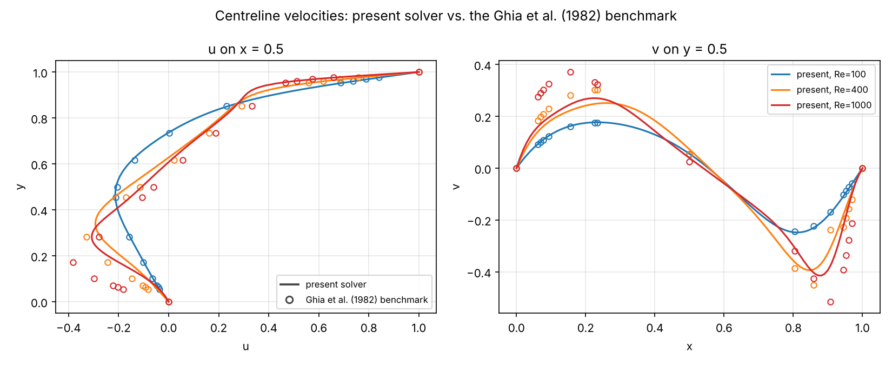

*Centreline velocities against Ghia's Tables I and II. At Re = 100 the
benchmark points sit on the computed curve; by Re = 1000 they separate, and
most of that separation is near the bottom wall.*

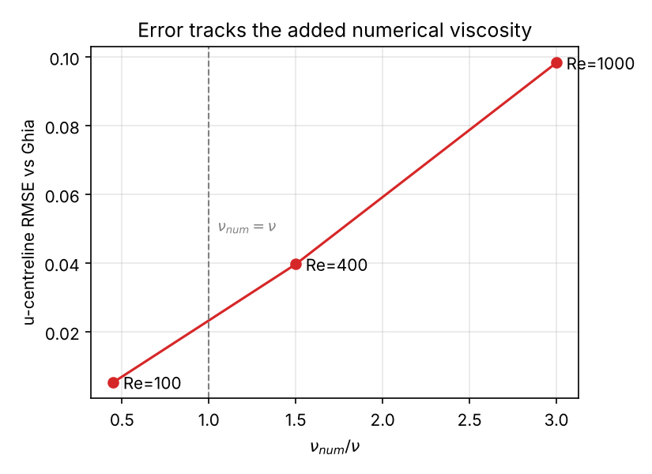

*The same three cases plotted against the viscosity ratio `ν_num/ν` rather than
against Re. The error rises close to linearly in that ratio across the range
tested. The dashed line marks `ν_num = ν`; the two cases that sit beyond it are
the two that disagree with the benchmark.*

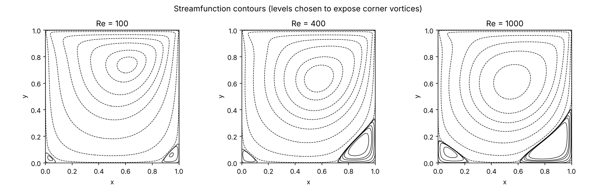

*Streamfunction contours alone, with levels chosen to expose the corner
vortices. The same fields appear over the vorticity field at the top of this
page.*

### Where the Re = 1000 error lives

```
y = 0.1719   Ghia -0.38289   mine -0.20015   diff +0.18274
y = 0.1016   Ghia -0.29730   mine -0.09105   diff +0.20625
y = 0.0703   Ghia -0.22220   mine -0.05308   diff +0.16912
```

Near the lid the error is small (0.004–0.017); near the bottom wall it is an
order of magnitude larger, and uniformly in the direction of **too weak**. That
is the bottom-left secondary vortex, which excess diffusion damages first while
the strong primary vortex survives. The mechanism predicts not just the
magnitude of the disagreement but its spatial signature.

### An honest caveat

The Re = 1000 run stopped at `dω = 5.8e-06` against `1e-7` for the other two,
with a Poisson residual of `1.2e-03` against `3e-05`. **Part of that 38% may be
incomplete convergence rather than numerical viscosity.** Rerun longer and check
whether `ψ_min` moves off −0.098759. If it barely moves, the attribution is
clean; if it moves, two effects have been conflated.

`runs/compare_all.py` flags any non-steady run for this reason.

---

## The full study

Everything above comes from the runs committed here: three Reynolds numbers on
`101²`. Between 22 and 25 September the solver was run at **all seven Reynolds
numbers Ghia et al. tabulate, on two to four grids each — twenty-one runs, up to
`257²`**. Those fields are several hundred megabytes and are not in this
repository; the figures and numbers below are from the
[report](../report/), and `report/cavity_analysis.py` is the script that
computed every one of them.

A `51²` run took under half an hour, a `257²` run between thirteen and
twenty-six. The `257²` run at Re = 100 needs 400 000 time steps and took
**47 hours**.

### First, the caveat above is now answered

The Re = 1000 run on this page stopped short of the steady criterion, and the
section above asks whether part of its disagreement is unconverged iteration
rather than numerical viscosity. The way to settle it is not to rerun longer
but to ask a different question: **is the final `ψ` actually a solution of
`∇²ψ = −ω` for the final `ω`?** Only the residual can say.

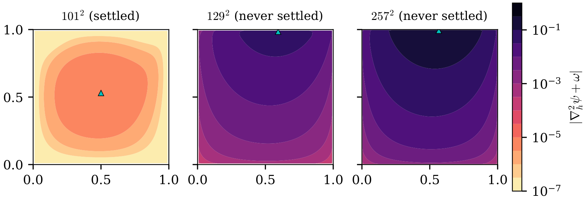

*Figure 11.2 — `|∇²ψ + ω|` over the interior at Re = 100. On `101²`, which
settled, it is below `10⁻⁵` everywhere. On `129²` and `257²`, which never did,
it exceeds `10⁻³` over nine-tenths of the cavity.*

Re-solving the discrete Poisson equation **exactly** for every saved vorticity
field changes `ψ_min` by **at most 0.41 %** (Re = 3200 on `129²`), and by less
than `10⁻⁵` relative for every run that reached steady state. The disagreement
with the benchmark is not an artefact of a loose Poisson solve. The attribution
to numerical viscosity stands.

It also exposed a second thing. The runs that never settled are the *finest*
grids at the *easiest* Reynolds number — the opposite of what one would guess.
The Poisson stopping test is the reason: one Jacobi sweep changes `ψ` by about
`h²δ_ω/4`, and the finer the grid the smaller `h²`, so the easier that test is
to pass. Each Poisson solve stops after a single sweep and `ψ` never catches up
with `ω`. The `4/Δx²` factor from [module 05](../05-poisson/), one more time.

### Three regimes

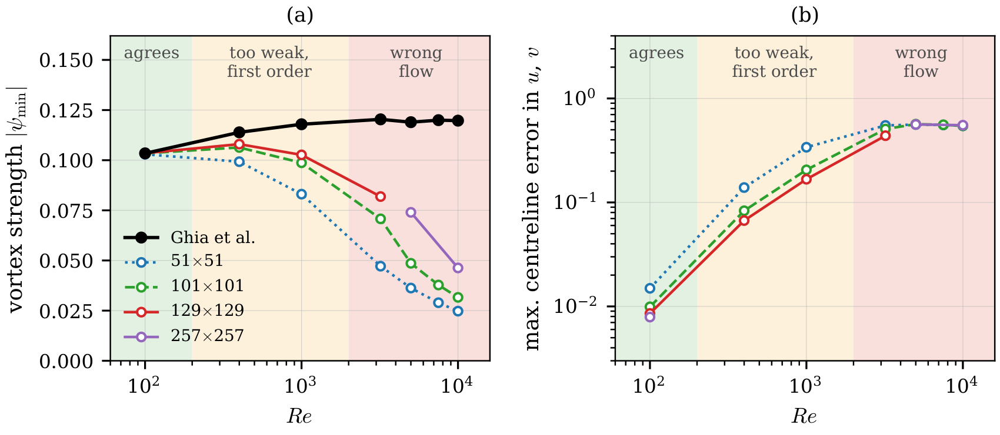

*Figure 11.3 — every run against the benchmark. (a) strength of the primary
vortex; (b) largest difference from Ghia's centreline velocities.*

On the finest grid available at each Reynolds number:

| Re | grid | `ψ_min` | Ghia | dev. | centreline | `ψ > 0` | regime |
|---|---|---|---|---|---|---|---|
| 100 | 257² | −0.103546 | −0.103423 | **0.12 %** | 0.008 | 0.9 % | agrees |
| 400 | 129² | −0.108010 | −0.113909 | −5.18 % | 0.067 | 5.3 % | too weak |
| 1000 | 129² | −0.102663 | −0.117929 | −12.94 % | 0.167 | 8.3 % | too weak |
| 3200 | 129² | −0.081883 | −0.120377 | −31.98 % | 0.438 | 28.8 % | **wrong flow** |
| 5000 | 257² | −0.074009 | −0.118966 | −37.79 % | 0.563 | 50.5 % | **wrong flow** |
| 7500 | 101² | −0.037783 | −0.119976 | −68.51 % | 0.558 | 45.5 % | **wrong flow** |
| 10000 | 257² | −0.046292 | −0.119731 | −61.34 % | 0.553 | 32.7 % | **wrong flow** |

*Table 11.3. Centreline error is the largest `|u − u_Ghia|` or `|v − v_Ghia|`
over Ghia's interior points. The last column is the share of the cavity where
`ψ > 0` — fluid turning against the lid.*

**Re = 100 — the solver agrees with the benchmark.** 0.02 % in vortex strength
on `101²`, within 0.12 % on every finer grid. The four grids give −0.102971,
−0.103441, −0.103498, −0.103546, converging at about **second** order
(observed 2.1 to 2.3). This is the case every later comparison is measured
against: the solver, its boundary conditions and its post-processing are right.

> The `101²` value here is −0.103441; the table earlier on this page reads
> −0.103439. They are two separate runs of the same case — this one with the
> Jacobi Poisson solve of the report, the other with the red–black SOR solve
> committed in `src/` — and they agree to **2 × 10⁻⁶**, about a thousandth of
> the distance to the benchmark. Neither number has been adjusted to match the
> other.

**Re = 400 and 1000 — the flow is right, the vortex too weak.** One clockwise
primary vortex and two corner eddies, in the right places. The strength is
5–13 % low on the finest grid, and the deficit *halves each time `Δx` halves*:

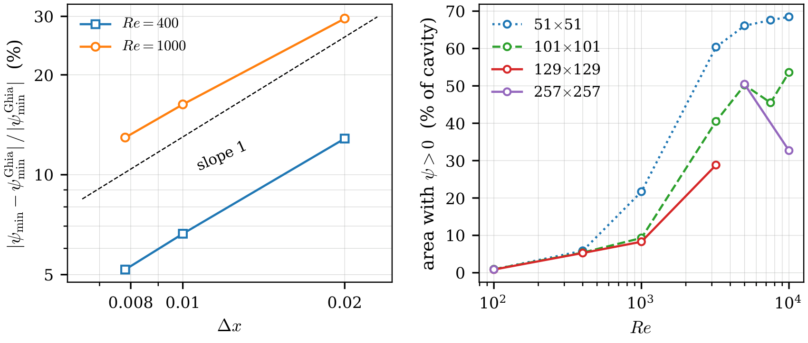

*Figure 11.6 — (a) the deficit in `ψ_min` against `Δx`, with a slope-1 reference.
12.9 %, 6.6 % and 5.2 % at Re = 400 and 29.6 %, 16.3 % and 12.9 % at Re = 1000,
on `51²`, `101²` and `129²`.*

**The error is first order in `Δx`** — observed order 0.85 at Re = 400 and 0.72
at Re = 1000 — which is exactly the order of the upwind scheme that causes it.
Extrapolating the `101²` and `129²` results to `Δx = 0` gives

| Re | extrapolated `ψ_min` | Ghia | difference |
|---|---|---|---|
| 400 | −0.113958 | −0.113909 | **0.04 %** |
| 1000 | −0.116752 | −0.117929 | **1.0 %** |

That is the strongest single result in the study. The disagreement at Re = 400
and 1000 is not a modelling error or a bug; it is the discretisation's own
first-order term, and removing it recovers the benchmark to **0.04 %** and
**1.0 %**.

**Re ≥ 3200 — the flow is wrong.** Here the vortex is 32–79 % too weak and,
instead of moving toward the centre as `Re` rises the way Ghia's does, it drifts
toward the **top-right corner**: from (0.56, 0.65) at Re = 3200 to (0.64, 0.71)
at 5000 and (0.75, 0.81) at 10000, where Ghia's stays near (0.51, 0.53). The
counter-rotating region, confined to the corner eddies in the benchmark, spreads
over 29–68 % of the cavity.

Extrapolating the two finest grids at first order still misses Ghia by −24 % and
−53 % at Re = 5000 and 10000. **Numerical viscosity alone does not explain this
regime**, and the report does not claim it does: what the runs show is that the
state was still changing at `t = 100` and that it recedes under refinement. The
cause is left open, with the tests that would settle it listed.

### The result worth taking away

At Re ≥ 5000 the centreline `v` on `51²` and `101²` agrees to **0.012**, while
that same `101²` solution differs from the benchmark by up to **0.57**.

> **Judged by `v` alone, those solutions would have been declared
> grid-independent.** They are wrong by fifty times the difference that test
> would have reported.

On the same two grids `u` differs by up to 0.12 and `ψ_min` by 22–25 % — so even
within the grid study, the quantity chosen decides the answer. A grid study
shows how much a solution changes with the grid. It cannot show that the
solution is right. That needs an independent result, and more than one quantity
from it.

<details>
<summary><b>The rest of the figures</b> — streamlines, vorticity and centrelines at all seven Reynolds numbers</summary>

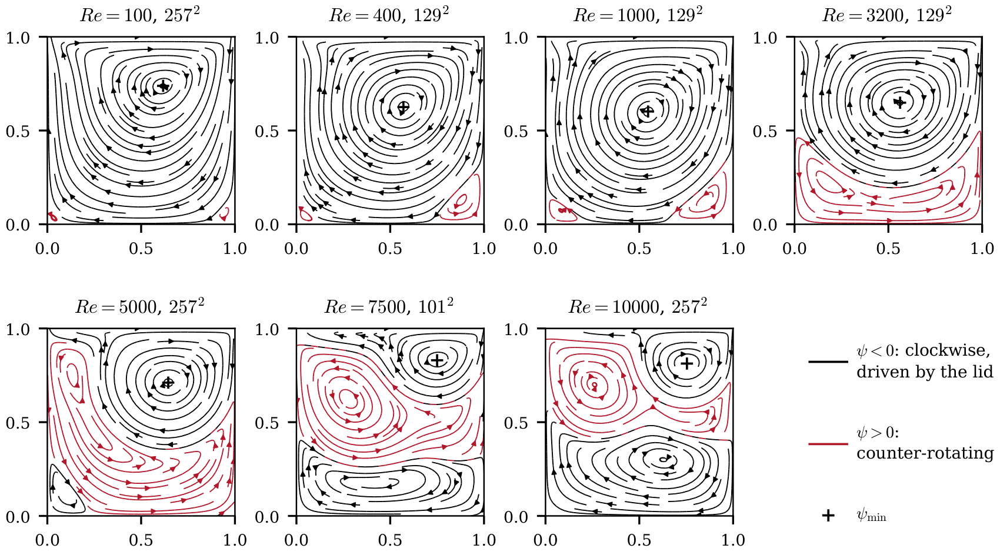

*Figure 11.4 — black where the fluid turns with the lid (`ψ < 0`), red where it
turns against (`ψ > 0`), `+` at `ψ_min`. Up to Re = 1000 the counter-rotating
flow is confined to the corner eddies; from Re = 3200 it fills a large part of
the cavity.*

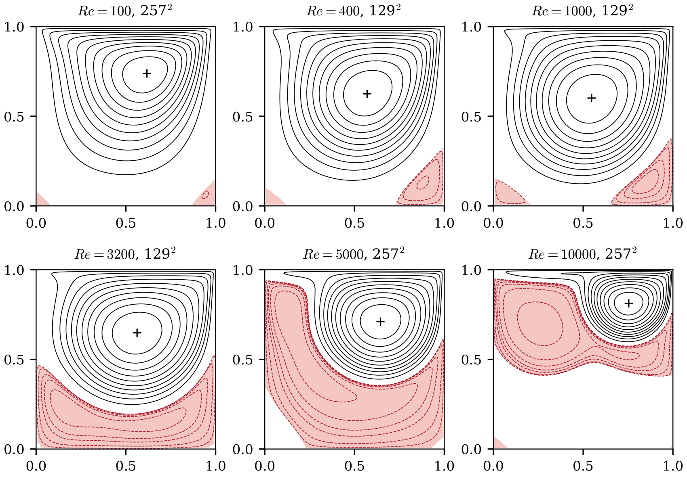

*Figure 11.10 — the same seven cases as streamfunction contours. Top row the
right flow, bottom row the wrong flow.*

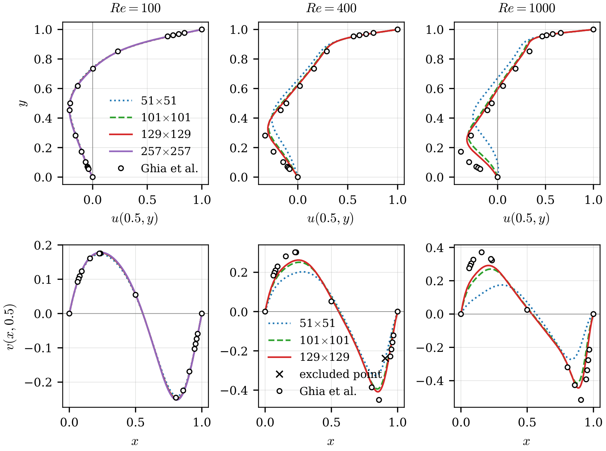

*Figure 11.5 — `u(0.5, y)` and `v(x, 0.5)` against Ghia's Tables I and II, on
three grids (four at Re = 100). `×` marks the one benchmark point excluded from
every comparison — see `report/cavity_analysis.py` for why.*

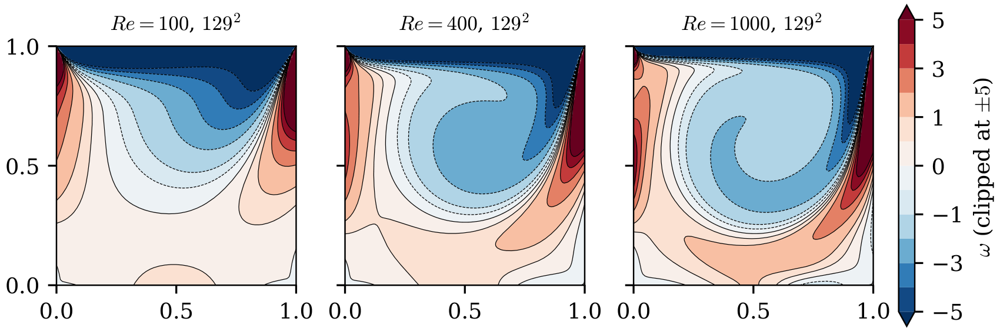

*Figure 11.7 — the colour scale is clipped at ±5; in the middle of the lid `ω`
runs −6 to −14, and next to the top-left corner it goes below −250. The
strongest vorticity is in the thin layer under the lid and at the two top
corners, not in the vortex. Inside the vortex it becomes more uniform as `Re`
rises: within the `ψ = 0.7ψ_min` contour its spread falls from 1.04 to 0.36 to
0.13.*

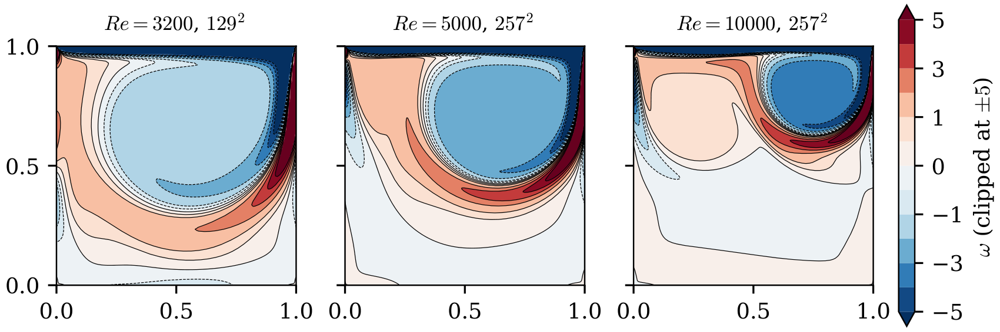

*Figure 11.9 — the same scale. The lid-driven vortex is still a core of nearly
uniform negative vorticity, but pushed into the top-right corner and wrapped in
a band of positive vorticity.*

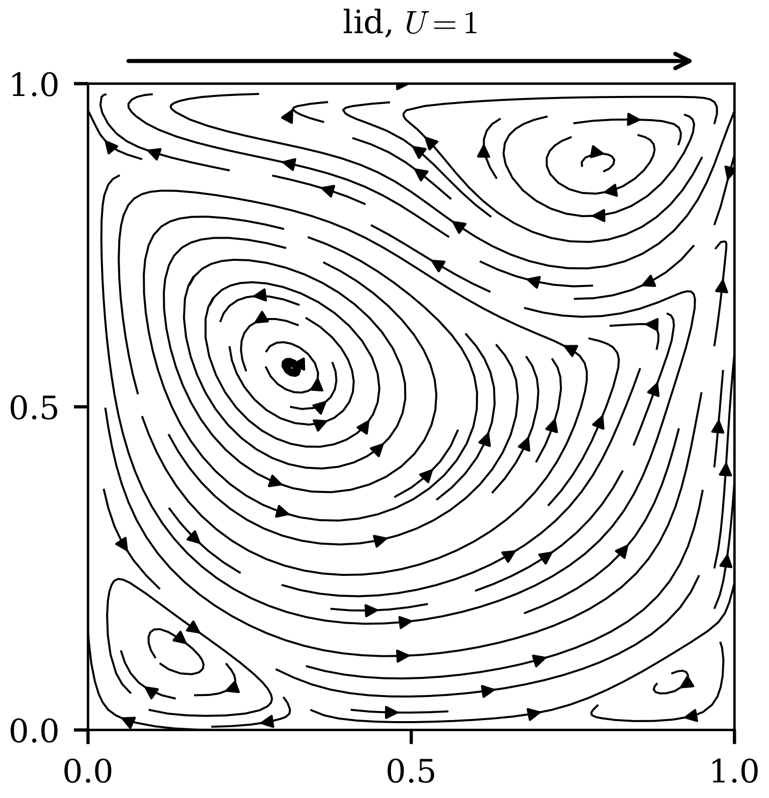

*Figure 11.8 — the clearest picture of the failure. On `51²` at Re = 10000 the
flow runs **up** the right-hand wall: the large vortex turns counter-clockwise
and the lid-driven one is squeezed into the top-right corner. Most of the cavity
is turning the wrong way.*

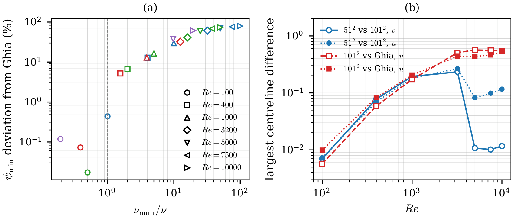

*Figure 12.1 — (a) the deviation of `ψ_min` from Ghia plotted against
`ν_num/ν` for all twenty-one runs, with the dashed line at `ν_num = ν`. Below
the line every error is under 1 %; above it they run from 5 % to 79 %. (b) the
grid study (blue, `51²` against `101²`) beside the validation (red, `101²`
against Ghia) — the result quoted above.*

</details>

### Why the benchmark does not have this error

Ghia et al. also use first-order upwinding, but only to keep their iteration
stable. At every iteration they add a **deferred correction** computed from the
previous iterate:

```
(u w)_x  ~=  upwind(u w)^{k+1}  +  [ CD-2(u w)^k  -  upwind(u w)^k ]
```

When the iteration has converged, `(uω)^{k+1} = (uω)^k`, the two upwind terms
cancel exactly and only the central difference is left. **Their converged
solution is second order and carries no numerical viscosity.** In this solver
the upwind difference is the whole scheme, so its viscosity stays in the answer.

Their diffusion terms and wall-vorticity formula are the same as the ones here,
so this deferred correction is the main difference between the two
discretisations — and adding it is the obvious next step.

---

## Reference data

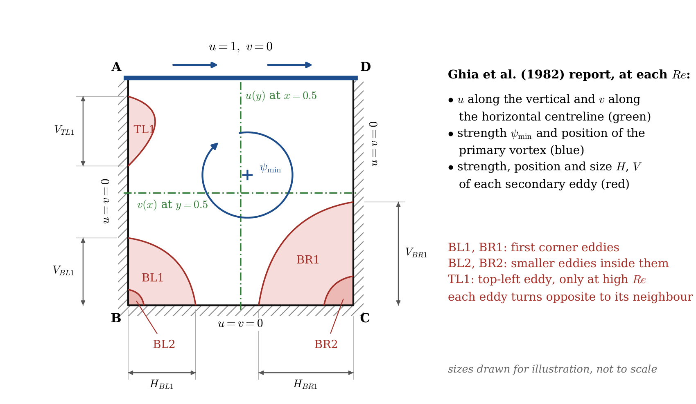

*Figure 11.1 of the [report](../report/) — the benchmark in Ghia's own notation.
They tabulate `u` along the vertical centreline and `v` along the horizontal
one, the strength and position of the primary vortex, and the strength, position
and size of each secondary eddy. Compared here: the centrelines and the primary
vortex. The corner eddies are not — their positions and sizes were never
extracted.*

`reference/ghia1982_table1_u.csv` and `ghia1982_table2_v.csv` hold the Re = 100,
400 and 1000 columns of Ghia, Ghia & Shin (1982) Tables I and II — `u` on the
vertical centreline and `v` on the horizontal centreline.

Transcribed from the paper by OCR, then cleaned: the scan renders minus signs as
`a.`, `AI.`, `XJ.` and splits digits (`0.7887 1`). Every value was
cross-checked. **Verify against your own copy before publishing error metrics** —
`tests/` checks structure (row counts, coordinate ordering, wall values, sign
changes) but cannot prove individual digits.

Note: the paper's printed heading on Table II reads "u-Velocity"; the quantity
tabulated is `v`.

---

## The first runs

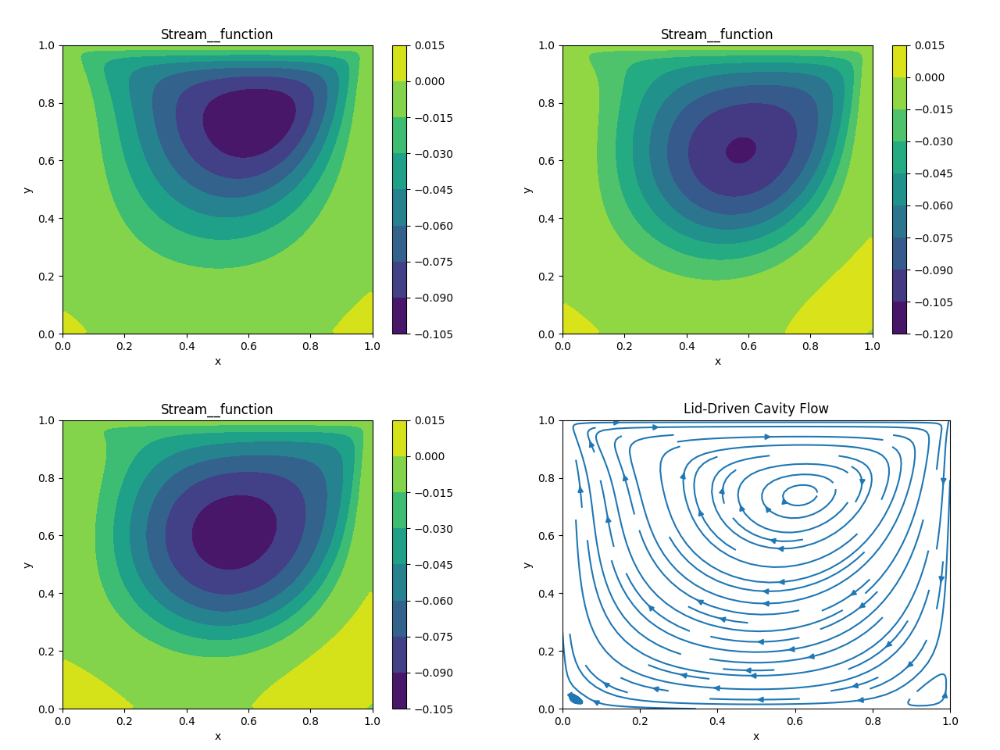

*Figure 10.2 of the [report](../report/) — the first cavity output that looked
like a cavity, 11 September. Default colour maps, default titles, three
streamfunction fields and a streamplot.*

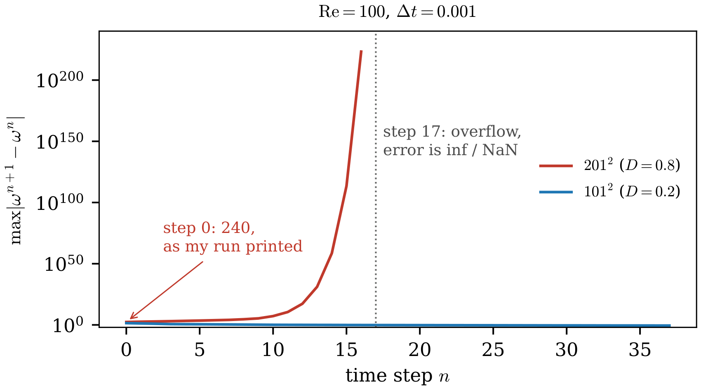

*Figure 10.3 — the same solver at Re = 100 and `Δt = 10⁻³` on two grids. In two
dimensions the explicit diffusion limit applies to the sum over both directions,
`D = νΔt(1/Δx² + 1/Δy²) = 2νΔt/Δx² ≤ 1/2`. On `101²`, `D = 0.2` and the run is
stable. Doubling the grid to `201²` quarters `Δx²` and takes `D` to **0.8**,
past the limit — and the run reaches `inf` at step 17.*

The printed error at step 0 was 240, and I read it as a bad initial transient
rather than as the first term of a geometric sequence. It is the same `D ≤ 1/2`
limit as the one-dimensional diffusion equation — refining the grid at fixed
`Δt` is what breaks it, which is the opposite of the instinct that a finer grid
is a safer one.

---

## Two fixes needed before extracting centrelines

Both present in `experiments/first_attempt_cavity.py`:

**`u` and `v` are never set on the boundaries.** Both loops run `range(1,n-1)`,
so `u[-1,:]` stays 0 where it should equal the lid speed 1. Harmless for the
interior march, but Ghia's Table I lists `y = 1.0000, u = 1.0000` — that row
would compare against zero. It is also why the streamplot shows a stationary lid.

**The Poisson stopping test measures the change per sweep, not the residual.**
Module 05 established the two differ by exactly `4/Δx²`; at `nx = 101` that is
**40,000×**. A tolerance of `1e-6` on the change corresponds to a residual near
`0.04`. Worth measuring the true residual once before publishing error tables.

---

## Theory

[**01 — What first-order upwind costs**](theory/01-numerical-viscosity.md) —
the full argument, the `Re_cell` analysis, the cost of reaching `Re_cell ≤ 2`
at Re = 1000 (a 501² grid, ~25× the cells), and the connection to module 02.

Module 02 reaches the same conclusion from wavenumber space: BD-1 needs 25.6
points per wavelength for 1% phase error, while the Re = 1000 boundary layer
(`~Re^-1/2 ≈ 0.03`) spans about **3 cells** on a 101² grid. Two analyses, one
answer.

---

## Code

| File | Purpose |
|---|---|
| `experiments/first_attempt_cavity.py` | The original hand-written solver, unchanged |
| `src/cavity.py` | Vectorised solver — boundary `u`/`v` fixed, residual-based SOR Poisson, saves fields |
| `src/numerical_viscosity.py` | `ν_num`, `Re_cell`, `Re_eff`, and the case table |
| `src/ghia_compare.py` | Centreline extraction, interpolation, error metrics |
| `reference/` | Ghia 1982 Tables I, II and V, Re = 100 / 400 / 1000 |
| `runs/make_figures.py` | Regenerates every figure from the saved runs |
| `runs/run_study.py` | Runs the parameter study, saves `.npz` per case |
| `runs/compare_all.py` | Error tables for every finished run |
| `tests/` | Eight checks across two suites |

### Why the Poisson solver changed

The first attempt used an absolute residual tolerance of `1e-6`. Since
residual = `4/Δx²` × change per sweep (module 05), at N=41 that demands a change
of ~`1e-12`: **2151 Jacobi sweeps per timestep**, which makes the solver
unusable. Switching to a *relative* tolerance and red-black SOR gave **8.7
sweeps per step** with `ψ_min` unchanged at −0.08982 — same answer, ~250×
faster. Module 05 measured the scaling exponents behind that (Jacobi 2.00,
SOR 1.04); this is where it pays.

Red-black ordering is used because it vectorises: updating all red points from
black neighbours then all black from red is Gauss–Seidel in a different sweep
order, which removes the sequential dependency.

The original solver is correct: Jacobi Poisson, ghost-point wall vorticity on all
four walls, conditional upwinding, central diffusion, explicit Euler, the
`v = −ψ_x` sign, corner exclusion, and the `o_old`/`o_new` discipline.

Runs completed: grids 51/101/201, Re 100/400/1000, `t* = 50/100/200`.

## Running

```bash
python3 tests/test_numerical_viscosity.py
python3 tests/test_ghia_compare.py

python3 runs/run_study.py            # all six cases (slow)
python3 runs/run_study.py 1000 201   # one case
python3 runs/compare_all.py          # summary
python3 runs/compare_all.py --full   # point by point
python3 runs/make_figures.py         # regenerates figures/
```

---

## Why the comparison is stronger for this

A disagreement with Ghia at Re = 1000 is not a failed validation. It is a
measured consequence of a documented property of the discretisation, predicted
from the modified equation before the comparison was run.

"My solver disagrees with the benchmark" is weak. "First-order upwind adds
`ν_num = 4.5ν` at this grid and Reynolds number, so it should behave like
`Re ≈ 180–500`, and here is the measurement confirming it" is a different kind
of statement.
