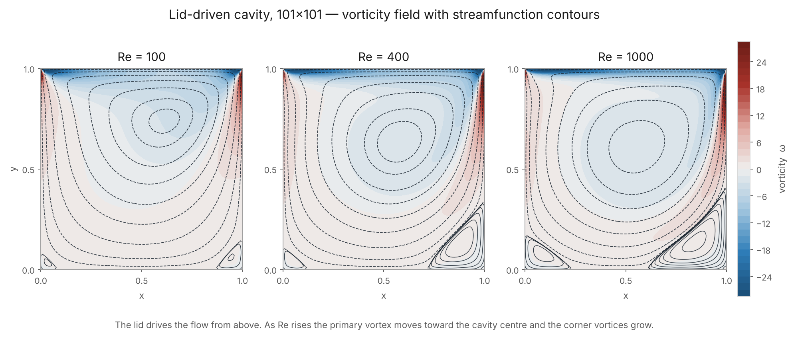
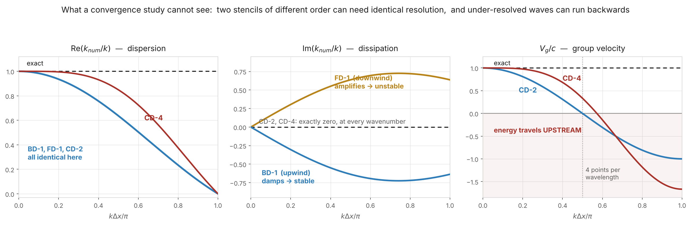

# CFD from Scratch

Finite-difference solvers for computational fluid dynamics, written from the
discretisation up — from the 1D linear advection equation to a lid-driven cavity
in vorticity–streamfunction form. **No CFD libraries.** Every scheme, every
solver and every verification test here was derived by hand first, then
implemented, then checked against something that could prove it wrong.



Each module keeps three things together that are usually kept apart:

| | |
|---|---|
| **`theory/`** | the derivation, done by hand, before any code exists |
| **`src/` + `tests/`** | the implementation, and evidence it is *correct* rather than merely runnable |
| **`experiments/`** | the original hand-written scripts, kept unchanged — including the ones with bugs |

---

## How it was built


Two months, seven stages, in the order they happened — and the reason the last
one works is the first one. The dashed arrow is the argument the whole project
turns on: **the numerical diffusion measured in Stage 1 is what limits the
cavity in Stage 7**, and it is measured there before it is needed here.

The 62-page write-up is in **[`report/`](report/)**, together with the two
scripts that generate every figure and every number in it.

## The six modules

| # | Module | What it establishes |
|---|---|---|
| 01 | [**Linear advection**](01-linear-advection/) | Six schemes; every stencil derived from Taylor series; measured orders against formal |
| 02 | [**Spectral analysis**](02-spectral-analysis/) | Numerical wavenumber, dispersion, dissipation, group velocity |
| 03 | [**2D advection**](03-advection-2d/) | The 2D CFL condition is a *sum*; Lax–Wendroff's cross-derivative term |
| 04 | [**Burgers**](04-burgers/) | Nonlinearity, conditional upwinding, shock formation |
| 05 | [**Poisson**](05-poisson/) | Jacobi, Gauss–Seidel, SOR; method of manufactured solutions |
| 06 | [**Lid-driven cavity**](06-lid-driven-cavity/) | Incompressible Navier–Stokes, validated against Ghia et al. (1982) |

Numbered by topic, not by build order. The derivations assume only calculus and
power series; every algebraic step is shown.

---

## Validation


**Solid lines are this solver. Open circles are Ghia's published benchmark
values.** Centreline velocities on a 101×101 grid, interpolated to Ghia's
tabulated coordinates.

At Re = 100 the circles sit on the line. At Re = 1000 they do not — and the rest
of this section is about why that was predictable.

| Re | u-centreline RMSE | `ψ_min` present | `ψ_min` Ghia | error | vortex position error |
|---|---|---|---|---|---|
| 100 | **0.00529** (1.95 %) | −0.103439 | −0.103423 | **0.02 %** | 0.0091 — under one cell |
| 400 | 0.03968 (21.96 %) | −0.106344 | −0.113909 | 6.64 % | 0.0428 |
| 1000 | 0.09834 (38.68 %) | −0.098759 | −0.117929 | 16.26 % | 0.0510 |

At Re = 100 the primary vortex matches the benchmark to **0.02 %** in strength
and to less than one grid spacing in position.

### Why the higher-Re cases drift

First-order upwind does not solve the equation you wrote. Its modified equation
adds a real diffusion,

```
ν_num = |u| Δx (1 − C) / 2
```

and in the vorticity transport equation that term sits directly alongside the
physical `ν`. Since `ν_num` depends on `Δx` and not on `ν`, raising the target
Reynolds number at fixed grid eventually lets it dominate:

For a converged steady run the `(1 − C)` factor is exactly one — a steady
solution no longer depends on the timestep — which leaves `ν_num/ν = Re Δx/2`.
On the 101×101 grid used here:

| Re | `ν` | `ν_num` | `ν_num/ν` | u RMSE |
|---|---|---|---|---|
| 100 | 0.0100 | 0.0050 | 0.50 | 0.00529 |
| 400 | 0.0025 | 0.0050 | **2.00** | 0.03968 |
| 1000 | 0.0010 | 0.0050 | **5.00** | 0.09834 |

The ratio crosses 1 between Re = 100 and Re = 400 — and that is exactly where
the error jumps hardest: **7.5×** from Re = 100 to 400, against 2.5× from 400 to
1000. The prediction came from the modified equation *before* the comparison was
run.

The Re = 1000 error is also **structured**: small near the lid, an order of
magnitude larger near the bottom wall, and always in the direction of *too
weak*. That is the bottom-left secondary vortex, which excess diffusion destroys
first while the strong primary vortex survives.

### The test that settles it

If the error is the upwind scheme's own first-order term, then removing that
term should recover the benchmark. In the [report](report/) the solver was run
at all seven of Ghia's Reynolds numbers on grids up to 257×257, and the deficit
in vortex strength does fall at **first order in `Δx`** — observed order 0.85 at
Re = 400 and 0.72 at Re = 1000. Extrapolating to `Δx = 0`:

| Re | extrapolated `ψ_min` | Ghia | difference |
|---|---|---|---|
| 400 | −0.113958 | −0.113909 | **0.04 %** |
| 1000 | −0.116752 | −0.117929 | **1.0 %** |

The disagreement is the discretisation, measured and then removed.

> **And where it does not work.** At Re ≥ 3200 no grid reproduces the benchmark
> flow, and first-order extrapolation still misses by −24 % and −53 % at
> Re = 5000 and 10000. Numerical viscosity does not explain that regime; the
> report says so and lists the tests that would settle it rather than claiming
> an answer it does not have.

---

## What a convergence study cannot see



Order of accuracy describes the limit `Δx → 0`. It says nothing about the grid
you can actually afford. Feeding `exp(ikx)` through each stencil answers the
second question — and gives two results a convergence study is blind to:

- **BD-1 and CD-2 need identical resolution** — 25.6 points per wavelength for
  1 % phase error — despite being first and second order. They share the real
  part `sin(K)/K`, and phase error lives entirely there. CD-4 needs 8.3.
- **Below four points per wavelength, group velocity changes sign.** For CD-2,
  `V_g/c = cos(K)`: under-resolved modes carry energy *upstream*, at full speed
  at `K = π`. Invisible to a convergence study (it vanishes as `Δx → 0`) and to
  a stability analysis (`|G| ≤ 1` throughout).

All eight closed forms were verified against the stencils themselves to `1e-14`.

### And what a grid study cannot see

The same blind spot appears once more, at the other end of the project, in the
tool normally used to decide that a CFD result is trustworthy.

At Re ≥ 5000 the centreline `v` computed on 51×51 and on 101×101 agrees to
**0.012**. That same 101×101 solution differs from Ghia's benchmark by up to
**0.57**.

> **Judged by `v` alone, those solutions would have been declared
> grid-independent** — while being wrong by roughly fifty times the difference
> that test reports.

Checking `u` instead gives 0.12, and `ψ_min` 22–25 %, so even within the grid
study the quantity chosen changes the verdict. A grid study measures how much an
answer moves when the grid changes. It cannot show the answer is right. That
takes an independent result, and more than one quantity from it.

---

## Start here

If you are learning this and want a route through:

1. **Understand why `u(x,t) = f(x − ct)`** before writing any code —
   [`01-linear-advection/theory/01-analytical-solution.md`](01-linear-advection/theory/01-analytical-solution.md).
   The method of characteristics also explains *why* upwinding works, which
   turns a rule you memorise into something obvious.
2. **Derive the stencils yourself** from Taylor series —
   [`02-finite-difference-stencils.md`](01-linear-advection/theory/02-finite-difference-stencils.md).
   Everything else is built on those six formulas.
3. **Write the simplest solver you can, and get it wrong.**
   [`01-linear-advection/BUGS.md`](01-linear-advection/BUGS.md) documents the four
   mistakes in my first attempt and what each one cost.
4. **Verify before you trust.** Measure the order of accuracy. A code that runs
   is not a code that is correct.
5. Then 2D, then nonlinear, then elliptic solvers, then Navier–Stokes.

Four things that cost me time, and are written up where they happened:

- *The bugs you can find are limited by the diagnostic you choose.* A frozen
  inflow boundary destroyed 10 % of a domain — 100 % error at `x = 0.5` — and was
  invisible because only `max(u)` was being printed.
- *A convergence order that gets **worse** under refinement is almost always the
  test, not the scheme.* Mine fell 1.97 → 1.30 because the Gaussian was not
  periodic on the domain.
- *Grid-independence is how you tell a real result from a numerical artefact.*
- *A test that cannot fail is not a test.* My first frozen-boundary check used
  `sin(πx)`, where the boundary value is zero either way.

The long form of all of this — derivations, all twenty-one cavity runs, and a
chapter on the mistakes — is the report in [`report/`](report/). Further
reading, including every paper used, is in [`RESOURCES.md`](RESOURCES.md).

---

## Running

```bash
pip install -r requirements.txt

cd 01-linear-advection
python3 advection_1d.py              # standalone upwind solver, explicit loops
python3 tests/test_convergence.py    # measured orders, exactness at C=1, conservation

cd ../06-lid-driven-cavity
python3 runs/compare_all.py          # Ghia error tables from the saved runs
python3 runs/make_figures.py         # regenerate this module's figures
```

Every figure a module generates for itself regenerates from committed data:
`figures/make_hero.py` and `figures/make_spectral.py` build the ones above, and
each module has its own `make_figures.py`.

The figures carried over from the report are listed in
[`report/README.md`](report/README.md); **17 of those 28 regenerate from nothing
but numpy and matplotlib** in about 25 seconds:

```bash
cd report
python3 -c "import make_all_figures as m; m.make_schematics(); m.make_journey(); m.make_overflow()"
```

Of the remaining 11, ten read the cavity run archive — several hundred
megabytes, not in this repository — and one is a screenshot.

---

## Author

**Akula Uday Kiran** — B.Tech Aerospace Engineering, RV College of Engineering,
Bengaluru. Written during a research internship in the Computational and
Theoretical Fluid Dynamics division, CSIR–National Aerospace Laboratories, under
Dr. V. K. Suman.

Interests: numerical methods for CFD — high-accuracy schemes, compact
discretisations, and spectral analysis of numerical error.

Released under the [MIT License](LICENSE), so that anyone who wants to learn
this can take it and use it.
