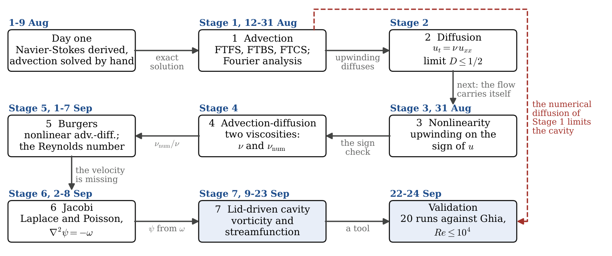
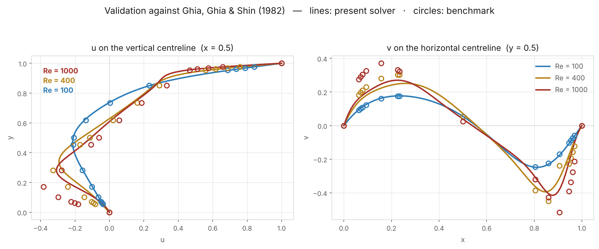

# CFD from Scratch

Finite-difference solvers written from the discretisation up — the 1D linear
advection equation through to a lid-driven cavity in vorticity–streamfunction
form. No CFD libraries. Every scheme was derived by hand, implemented, then
checked against something that could prove it wrong.


Writing the solver is the smaller half of the work. The larger half is knowing
how wrong it is, and why — which is what most of this repository is about.

### Three results

1. At Re = 100 the cavity matches the Ghia et al. (1982) benchmark to
   **0.02 %** in vortex strength, and to less than one cell in position.

2. At Re = 400 and 1000 it does not — by 6.6 % and 16.3 %. That gap was
   predicted from the scheme's modified equation *before* it was measured. It
   falls at first order in `Δx`, as predicted, and extrapolating it away
   recovers the benchmark to **0.04 %** and **1.0 %**.

3. At Re ≥ 5000, two grids agree with each other to 0.012 while sitting 0.57
   from the benchmark. **A grid-independence study would have certified a wrong
   answer.**

If you are here to learn rather than to assess, start at
[Start here](#start-here) instead.

---

## How it is organised



Two months, seven stages, in the order they happened. The dashed arrow is the
argument the whole project turns on: the numerical diffusion measured in Stage 1
is what limits the cavity in Stage 7 — measured there, before it was needed
here.

| # | Module | What it establishes |
|---|---|---|
| 01 | [Linear advection](01-linear-advection/) | Six schemes; every stencil derived from Taylor series; measured orders against formal |
| 02 | [Spectral analysis](02-spectral-analysis/) | Numerical wavenumber, dispersion, dissipation, group velocity |
| 03 | [2D advection](03-advection-2d/) | The 2D CFL condition is a *sum*; Lax–Wendroff's cross-derivative term |
| 04 | [Burgers](04-burgers/) | Nonlinearity, conditional upwinding, shock formation |
| 05 | [Poisson](05-poisson/) | Jacobi, Gauss–Seidel, SOR; method of manufactured solutions |
| 06 | [Lid-driven cavity](06-lid-driven-cavity/) | Incompressible Navier–Stokes, validated against Ghia et al. (1982) |

Numbered by topic, not by build order. The derivations assume only calculus and
power series, and every algebraic step is shown.

Each module keeps three things together that are usually kept apart:

- **`theory/`** — the derivation, by hand, before any code exists.
- **`src/` and `tests/`** — the implementation, and evidence it is *correct*
  rather than merely runnable.
- **`experiments/`** — the original hand-written scripts, unchanged, including
  the ones with bugs.

The 62-page write-up is in [`report/`](report/), with the two scripts that
generate every figure and every number in it.

---

## Validation



Solid lines are this solver; open circles are Ghia's published values.
Centreline velocities on a 101×101 grid, interpolated to their tabulated
coordinates.

| Re | u-centreline RMSE | `ψ_min` present | `ψ_min` Ghia | error | vortex position |
|---|---|---|---|---|---|
| 100 | 0.00529 | −0.103439 | −0.103423 | **0.02 %** | 0.0091 — under one cell |
| 400 | 0.03968 | −0.106344 | −0.113909 | 6.64 % | 0.0428 |
| 1000 | 0.09834 | −0.098759 | −0.117929 | 16.26 % | 0.0510 |

At Re = 100 the circles sit on the line. At Re = 1000 they do not, and the rest
of this section is about why that was foreseeable.

### The error was predicted first

First-order upwind does not solve the equation you wrote. Its modified equation
adds a real diffusion of its own,

```
ν_num = |u| Δx (1 − C) / 2
```

and in the vorticity transport equation that term sits directly alongside the
physical `ν`. For a converged steady run the `(1 − C)` factor is exactly one — a
steady solution no longer depends on the timestep — which leaves

```
ν_num / ν  =  Re · Δx / 2
```

On this grid that is 0.50, 2.00 and 5.00 for the three cases above. **The ratio
crosses 1 between Re = 100 and Re = 400, and that is exactly where the error
jumps hardest:** 7.5× across that interval, against 2.5× from 400 to 1000. The
prediction came out of the modified equation before the comparison was run.

The Re = 1000 error is also structured — small near the lid, an order of
magnitude larger near the bottom wall, and always in the direction of *too
weak*. That is the bottom-left secondary vortex, which excess diffusion destroys
first while the strong primary vortex survives.

### Then measured, then removed

If the gap really is the upwind scheme's own first-order term, taking that term
to zero should recover the benchmark. In the [report](report/) the solver runs
at all seven of Ghia's Reynolds numbers on grids up to 257×257. The deficit does
fall at first order in the grid spacing — observed order 0.85 at Re = 400 and
0.72 at Re = 1000 — and extrapolating it to zero spacing gives:

| Re | extrapolated `ψ_min` | Ghia | difference |
|---|---|---|---|
| 400 | −0.113958 | −0.113909 | **0.04 %** |
| 1000 | −0.116752 | −0.117929 | **1.0 %** |

The disagreement is the discretisation, predicted and then accounted for.

> **Where this stops working.** At Re ≥ 3200 no grid here reproduces the
> benchmark flow, and the same extrapolation still misses by 24 % and 53 % at
> Re = 5000 and 10000. Numerical viscosity does not explain that regime. The
> report says so, and lists the tests that would settle it, rather than
> claiming an answer it does not have.

---

## What the usual diagnostics miss


Two standard checks — order of accuracy, and a grid-independence study — are
blind to things this project ran into directly.

**Order of accuracy describes the limit `Δx → 0`.** It says nothing about the
grid you can afford. Feeding `exp(ikx)` through each stencil answers that second
question instead, and gives two results the order alone cannot:

- BD-1 and CD-2 need identical resolution — 25.6 points per wavelength for 1 %
  phase error — despite being first and second order. They share the real part
  `sin(K)/K`, and phase error lives entirely there. CD-4 needs 8.3.
- Below four points per wavelength, group velocity changes sign. For CD-2,
  `V_g/c = cos(K)`: under-resolved modes carry energy *upstream*, at full speed
  at `K = π`. Invisible to a convergence study, since it vanishes as `Δx → 0`,
  and to a stability analysis, since `|G| ≤ 1` throughout.

All eight closed forms were verified against the stencils themselves to `1e-14`.

**A grid study measures how much an answer moves, not whether it is right.** At
Re ≥ 5000 the centreline `v` computed on 51×51 and on 101×101 agrees to 0.012,
while that same 101×101 solution differs from the benchmark by up to 0.57 —
wrong by roughly fifty times the difference the test reports. Checking `u`
instead gives 0.12, and `ψ_min` 22–25 %, so even within the grid study the
quantity chosen decides the verdict.

Showing a result is right takes an independent result, and more than one
quantity from it.

---

## Start here

A route through, if you are learning this:

1. **Understand why `u(x,t) = f(x − ct)`** before writing any code —
   [the analytical solution](01-linear-advection/theory/01-analytical-solution.md).
   The method of characteristics also explains *why* upwinding works, which
   turns a rule you would otherwise memorise into something obvious.
2. **Derive the stencils yourself** from Taylor series —
   [where the stencils come from](01-linear-advection/theory/02-finite-difference-stencils.md).
   Everything after this is built on those six formulas.
3. **Write the simplest solver you can, and get it wrong.**
   [`BUGS.md`](01-linear-advection/BUGS.md) has the four mistakes in my first
   attempt and what each one cost.
4. **Verify before you trust.** Measure the order of accuracy. A code that runs
   is not a code that is correct.
5. Then 2D, then nonlinear, then elliptic solvers, then Navier–Stokes.

Four things that cost me time, each written up where it happened:

- *The bugs you can find are limited by the diagnostic you choose.* A frozen
  inflow boundary destroyed 10 % of a domain — 100 % error at `x = 0.5` — and
  stayed invisible because only `max(u)` was being printed.
- *A convergence order that gets worse under refinement is almost always the
  test, not the scheme.* Mine fell 1.97 → 1.30 because the Gaussian was not
  periodic on the domain.
- *Grid-independence tells you a result is stable, not that it is right.*
- *A test that cannot fail is not a test.* My first frozen-boundary check used
  `sin(πx)`, where the boundary value is zero either way.

The long form of all of it — derivations, all twenty-one cavity runs, and a
chapter on the mistakes — is the [report](report/). Further reading, including
every paper used, is in [`RESOURCES.md`](RESOURCES.md).

---

## Running

```bash
pip install -r requirements.txt

cd 01-linear-advection
python3 advection_1d.py              # standalone upwind solver, explicit loops
python3 tests/test_convergence.py    # measured orders, exactness at C=1, conservation

cd ../06-lid-driven-cavity
python3 runs/compare_all.py          # Ghia error tables from the saved runs
python3 runs/make_figures.py         # regenerate this module's figures
```

Every figure a module generates for itself rebuilds from committed data. Each
module has its own `make_figures.py`; the two scripts in `figures/` build the
ones on this page.

The figures carried over from the report are indexed in
[`report/README.md`](report/README.md). Seventeen of those twenty-eight rebuild
from nothing but numpy and matplotlib, in about 25 seconds:

```bash
cd report
python3 -c "import make_all_figures as m; m.make_schematics(); m.make_journey(); m.make_overflow()"
```

Of the remaining eleven, ten read the cavity run archive — several hundred
megabytes, not in this repository — and one is a screenshot.

---

## Author

**Akula Uday Kiran** — B.Tech Aerospace Engineering, RV College of Engineering,
Bengaluru. Written during a research internship in the Computational and
Theoretical Fluid Dynamics division, CSIR–National Aerospace Laboratories, under
Dr. V. K. Suman.

Interests: numerical methods for CFD — high-accuracy schemes, compact
discretisations, and spectral analysis of numerical error.

Released under the [MIT License](LICENSE), so that anyone who wants to learn
this can take it and use it.
